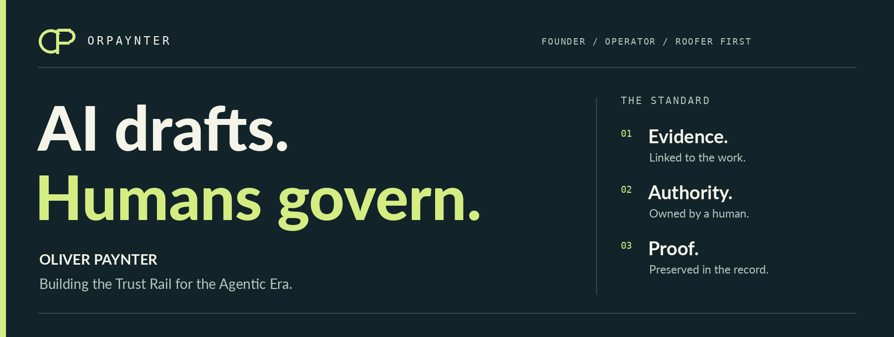
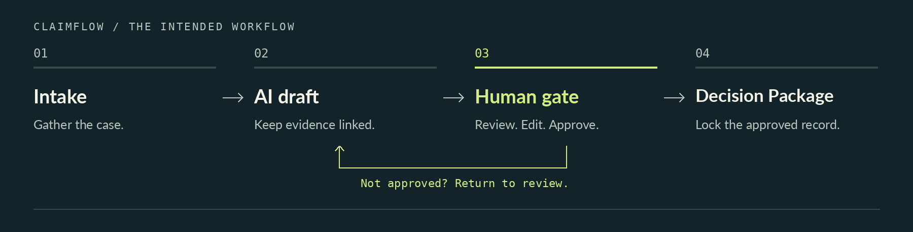

  <picture>
    <source media="(max-width: 600px)" srcset="./assets/orpaynter-banner-mobile.png">
    
  </picture>

  
  
  
  

# Oliver Paynter

**Founder / CEO, [OrPaynter, Inc.](https://github.com/Orpaynter-Inc)**  
Roofer first. Building a governed AI workforce from real field work.

A real objective becomes evidence-bound work, an authorized action, a verified outcome, and a useful next cycle. Learning cannot grant itself more control.

Roofing claims are the first proving ground. They are not the limit of the company.

**AI drafts. A named human approves. The record stays reconstructable.**

  <a href="https://orpaynter.ai"><b>See the system</b></a> ·
  <a href="https://orpaynter.ai/claimflow"><b>Walk ClaimFlow</b></a> ·
  <a href="https://orpaynter.ai/proof"><b>Inspect the proof</b></a> ·
  <a href="https://github.com/Orpaynter-Inc"><b>Company</b></a> ·
  <a href="mailto:Ov@orpaynter.com"><b>Talk to Oliver</b></a>

---

## What this account is

| | |
|---|---|
| **Company** | Delaware C-Corp. Software company. Not the trade company. |
| **Founder** | Dallas–Fort Worth roofer first, then the system. Public GitHub location: Nantucket, MA. |
| **Trade company** | Oliver’s Roofing & Contracting. Domain foundation and first real customer. Separate entity. |
| **Public product** | [orpaynter.ai](https://orpaynter.ai) — ClaimFlow Pilot. “AI drafts. You govern.” |
| **Public source** | [orpaynter-Overlay](https://github.com/orpaynter/orpaynter-Overlay) — world front door, MIT, upstream OSIRIS credit kept. |
| **This account** | Founder and build trail. Company face is [Orpaynter-Inc](https://github.com/Orpaynter-Inc). Canonical repos transfer there later. |
| **Status** | Phase 1. Synthetic demos are labeled synthetic. No booked revenue, certification, or customer count is claimed. |

**Stop drowning in claims. Start closing them.**

---

## One company, distinct jobs

> **Web sells. ClaimFlow proves. ORPA controls. DecisionPackage verifies. Overlay shows the world. AIA holds authority.**

| Surface | Job | Boundary |
|---|---|---|
| **[World / site](https://orpaynter.ai)** | Discovery, proof, inquiry | An inquiry is not an order or a charge |
| **[Overlay](https://github.com/orpaynter/orpaynter-Overlay)** | Place, time, public signals, preserved context | A view is not a survey, measured CAD, or execution authority |
| **AIA** | Objective, policy, approval, durable records | Workers cannot approve their own consequences |
| **[ClaimFlow](https://orpaynter.ai/claimflow)** | One case. Evidence-linked draft. Human gate. | Synthetic demo ≠ customer result or carrier decision |
| **ORPA** | Identity-bound approve / reject / escalate | Payments off. Fail closed. Authority stays in ClaimFlow |
| **Agent Factory** | Evolve capability in a sandbox | Fitness never grants production authority |
| **Learning** | Keep what measurement supports | Capability may grow. Authority may not self-expand |

Objective → evidence → specialist work → owner decision → execution → receipt → verified outcome → learning.

Current boundary, from the factory reconciliation: **Agent Factory evolves capability → Agent Contract handoff → Workflow Automator organizes work → TRAE governs authority → Execution → DecisionPackage / proof → Outcome Loop.**

---

## The first proving ground

A contractor does not lose claims because they lack photos. They lose them because photos, estimates, weather, notes, and pricing never become one package a named person can stand behind.

  <picture>
    <source media="(max-width: 600px)" srcset="./assets/claimflow-workflow-mobile.png">
    
  </picture>

| Step | What happens | Who owns it |
|---|---|---|
| **Gather** | Photos, files, notes, and claim context enter one case. | The job |
| **Draft** | AI organizes gaps and an evidence-linked package. | The system |
| **Gate** | A named human approves, rejects, or returns the work. | The person |
| **Lock** | Decision, reviewer, evidence, and context stay together. | The record |
| **Learn** | Verified results can inform the next cycle. | The owner |

The public [ClaimFlow demo](https://orpaynter.ai/claimflow) is synthetic. Dollars, drafts, and evidence rows there are fabricated so the gate can be walked without a live claim.

---

## What the repos actually prove

Dated local and engineering evidence. Not traction. Full public write-up: [orpaynter.ai/proof](https://orpaynter.ai/proof).

| Evidence | Establishes | Does not establish |
|---|---|---|
| **ORPA v0.5.0-rc1** | Proofs 1–4 together, 30/30 scenarios. Identity-bound review, dissent visibility, evidence provenance, portable verify. Bad paths fail closed. Payments cannot be mutated from the console. | A customer pilot, payment, or production SaaS. Repo is private. |
| **AIA bounded live loop** · Oct 2, 2026 | Two owner-approved runs kept outputs, receipts, and measured outcomes. Second run reused the verified field-type rule. | Customer revenue, carrier submission, or general judgment improvement. |
| **Grok instruction learning** · Oct 2, 2026 | 25 retained sessions. Three history-derived instruction edits applied and verified. Two actions deferred. | A measured lift on new tasks. |
| **World Portal / Overlay** · Sep 30–Oct 4, 2026 | Frozen, source-bound job survived restart. Globe, captures, and bounded recovery run locally. 124 focused tests and 13 runtime fault checks in the recovery acceptance. | External action, hosted multi-user service, or a customer claim. |
| **ClaimFlow release path** | `FINAL_GATE → RELEASED` is governance-bound. Direct release fails closed. | Durable Postgres atomicity or signed production artifacts. Those remain blockers. |
| **Agent Factory** | Sandbox evolution is separate from promotion. Approval is hash-bound to the genome. Fitness cannot approve. Forge kernel: CI verified, 16/16 tests. | An independent security audit, live ClaimFlow enforcement, or a production control plane. |

**Next result that counts:** one real claim, scope and fees in writing, delivered package judged against that agreement. A proposed ClaimFlow package fee exists at $249. It is not booked revenue. An inquiry is a conversation.

---

## How to read this account

About 59 repositories. Most are private. Read them in this order. A newer demo does not outrank evidence.

| Layer | Repos | Read as |
|---|---|---|
| **Canonical** | [AIA](https://github.com/orpaynter/AIA) · [claimflow](https://github.com/orpaynter/claimflow) · [orpa](https://github.com/orpaynter/orpa) · [orpaynter-web](https://github.com/orpaynter/orpaynter-web) | Current product direction. Private until transfer. |
| **Public world** | [orpaynter-Overlay](https://github.com/orpaynter/orpaynter-Overlay) · [claimflow-app](https://github.com/orpaynter/claimflow-app) | Inspectable source. Overlay credits [OSIRIS](https://github.com/simplifaisoul/osiris). |
| **Operator stack** | [agents](https://github.com/orpaynter/agents) · [ai-agent-factory](https://github.com/orpaynter/ai-agent-factory) · [orpaynter-agent-factory](https://github.com/orpaynter/orpaynter-agent-factory) · [orpaynter-mcp-server](https://github.com/orpaynter/orpaynter-mcp-server) | Foremen, factory, and lead tooling. Not self-promoting authority. |
| **Map** | This repo | Canonical vs historical. Start here if the account looks noisy. |
| **Historical** | `THE-ONE`, `Main`, `orpaynter-platform`, `website`, `ai-roofing-platform`, super-nexus experiments, CDN, starters | Earlier roofs of the same idea. Not the current system of record. |

Company identity defines who we are. Canonical repositories define what the product does. Real jobs and tests define what works.

---

## Operating law

1. The system drafts. A named human approves.
2. Agents may get more competent. They may never give themselves more authority.
3. Money-facing and customer-facing actions need a reconstructable Decision Package plus evidence.
4. Synthetic demonstrations stay labeled synthetic.
5. Checkout is not paid. Paid is not entitled. A package existing is not a package approved.
6. Evolution may be automated. Authority escalation may not be self-approved.
7. No accuracy, ROI, headcount, certification, uptime, or “investor ready” claims without proof from real work.

---

## Company boundary

**OrPaynter, Inc.** builds the software.

**Oliver’s Roofing & Contracting** is the trade company and the domain foundation. Same founder. Not the same entity.

---

## Build with us

Roofing, claims, field operations, insurance, or governed AI — if faster systems should still leave a human clearly accountable, start here.

| | |
|---|---|
| **Product** | [orpaynter.ai](https://orpaynter.ai) |
| **Demo** | [ClaimFlow](https://orpaynter.ai/claimflow) |
| **Proof** | [orpaynter.ai/proof](https://orpaynter.ai/proof) |
| **Source** | [Overlay](https://github.com/orpaynter/orpaynter-Overlay) · [Company](https://github.com/Orpaynter-Inc) |
| **Email** | [Ov@orpaynter.com](mailto:Ov@orpaynter.com) |

OrPaynter, Inc. · Built on Trust. Powered by AI. · Patent-Pending. · AI drafts. You govern.

